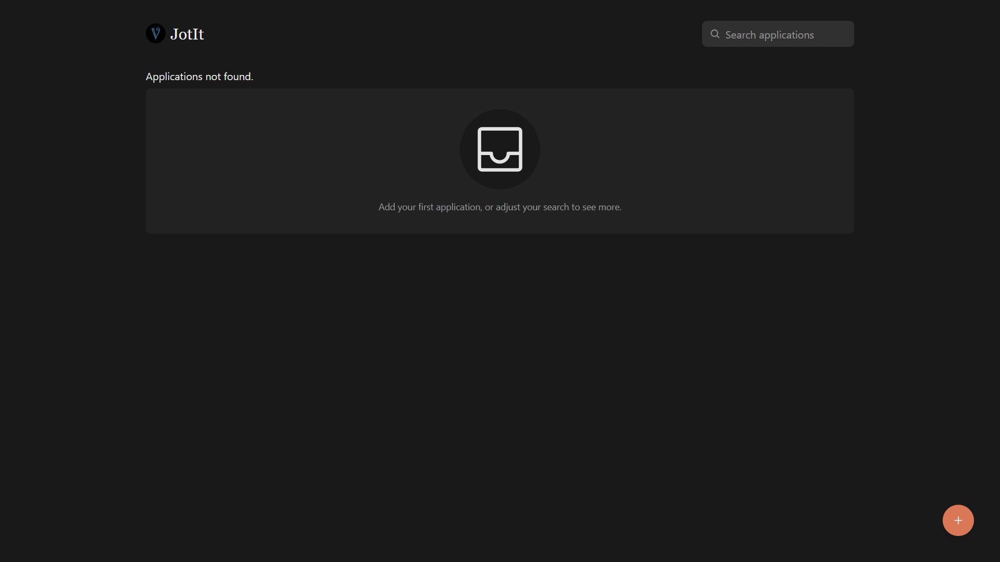
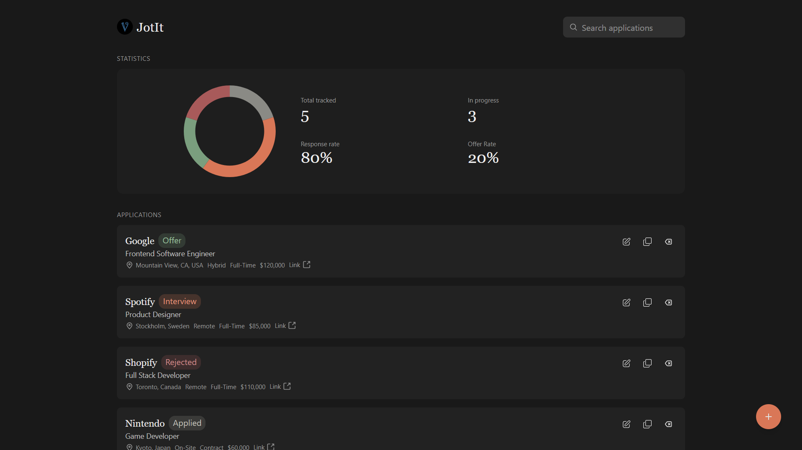
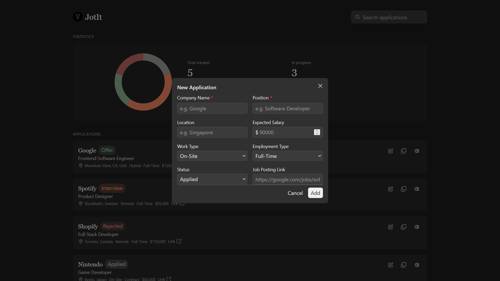
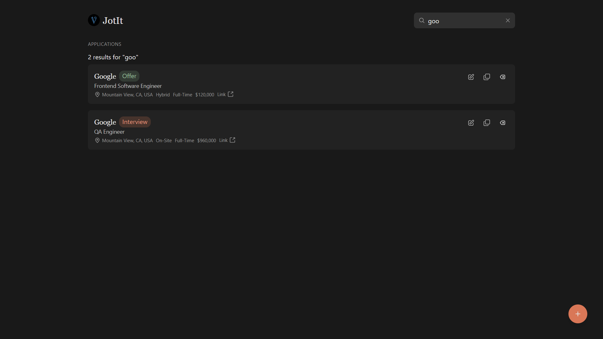
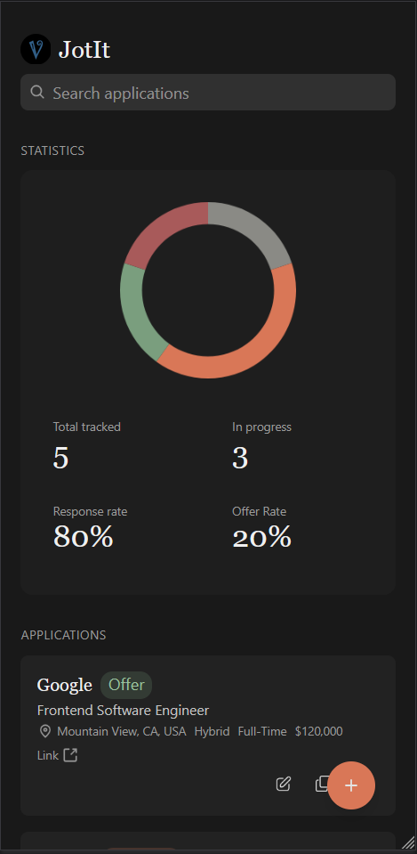
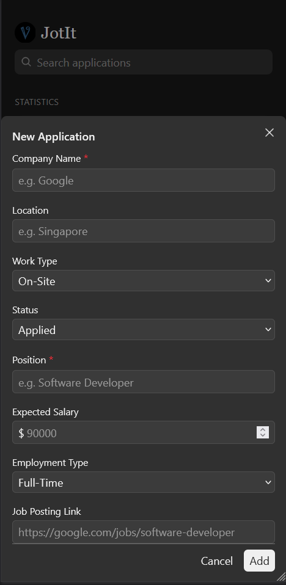

# JotIt
A job application tracker made with React, TypeScript, and Tailwind CSS

## Features
1. Create, edit, duplicate and delete applications
2. Search capabilities through company, position, and etc.
3. Stored in localStorage with no backend

## Live Demo
[Link](https://victosn.github.io/JotIt/)

## How it works
The app is a single React client and all the data access goes through [src/api/application.ts](src/api/application.ts), which persists the applications to the browser's localStorage.

### Frontend
- The [App.tsx](src/App.tsx) owns the main application states
- On the first load, App reads all applications into state. The statistics then are calculated from the applications array
- The [AddModal](src/components/add/AddModal.tsx) controls whether the form is open or not, [AddApplication](src/components/add/AddApplication.tsx) contains the form itself and it is used for both creating and editing applications

## Scripts
| Command | Description |
| --- | --- |
| `npm run dev` | Start the Vite development server |
| `npm run build` | Type-check and build the client |
| `npm run lint` | Run ESLint |
| `npm run preview` | Preview the production build |

## Prerequisites
- Node.js 20+

## Screenshots
### Default Interface


### Main Interface


### Add Interface


### Search


### Mobile View 1
<p align="center">
  
</p>

### Mobile View 2
<p align="center">
  
</p>

## How to run
1. Clone the repo
2. Run:

```bash
npm install
```

3. Run:
```bash
npm run dev
```

## License
This project is licensed under the [MIT License](LICENSE)
