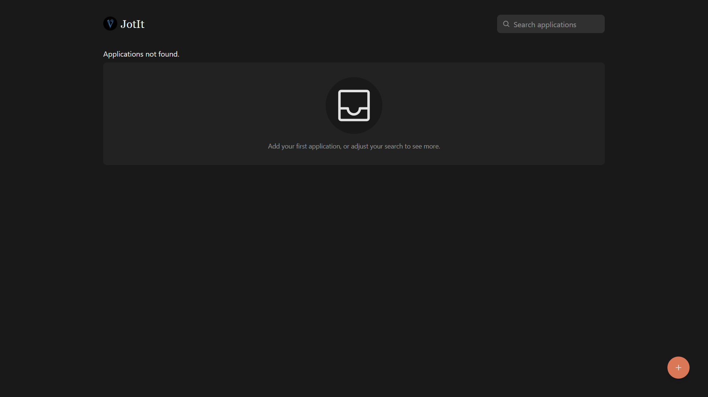
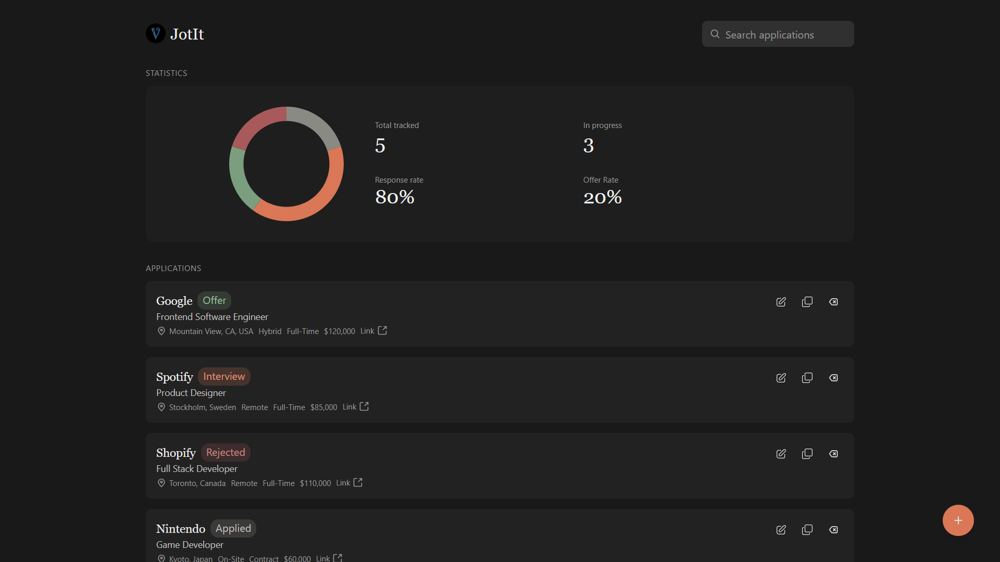
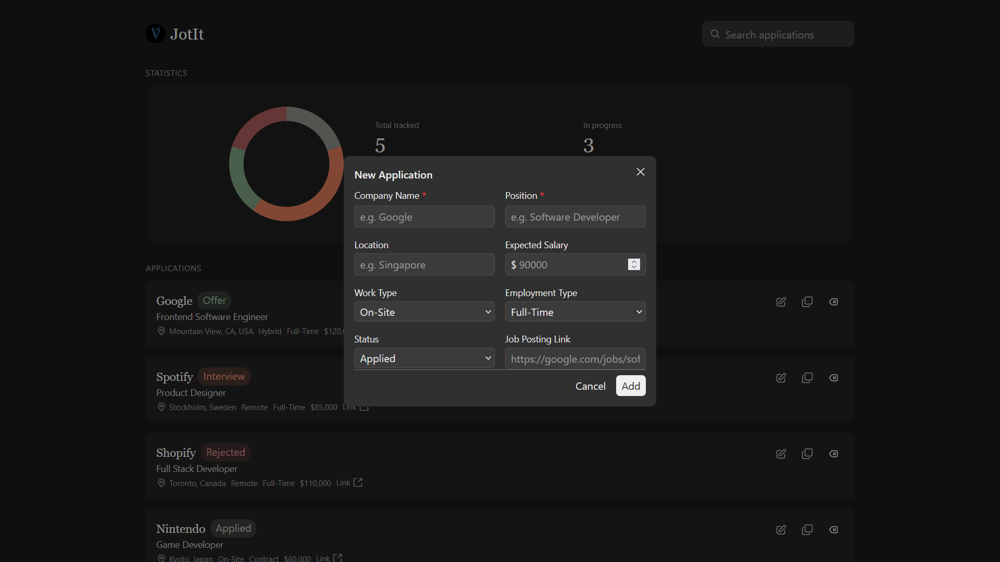
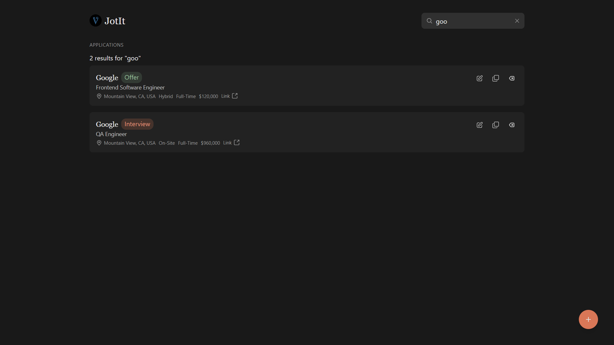
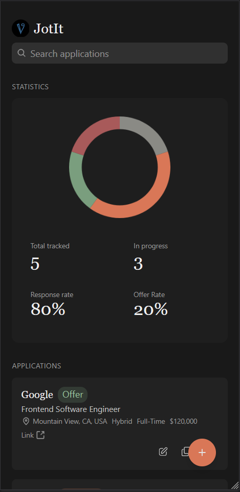
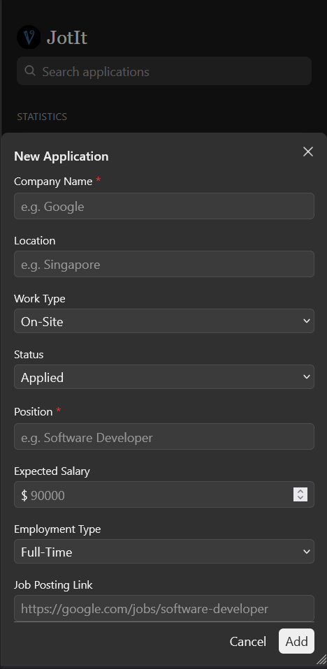

# JotIt
A job application tracker made using MERN stack with TypeScript and Tailwind CSS

## Features
1. Create, edit, duplicate and delete applications
2. Search capabilities through company, position, and etc.
3. Stored in MongoDB Atlas
4. Rest API built with Express and Node.js

## How it works
The app is split into 2 parts: a React client for the frontend and an Express/MongoDB API for the backend

### Frontend
- The [App.tsx](src/App.tsx) owns the main application states
- On the first load, App calls for all applications and stores it. The statistics then are calculated from the applications array
- The [AddModal](src/components/add/AddModal.tsx) controls whether the form is open or not, [AddApplication](src/components/add/AddApplication.tsx) contains the form itself and it is used for both creating and editing applications
- The API calls are centralized in [src/api/application.ts](src/api/application.ts), which wraps the fetch and throws when the server returns a result which is not a 2xx response

### Backend
- [src/server/index.ts](src/server/index.ts) creates the Express app that enables the CORS and JSON parsing, mounts [src/server/routes/applications.ts](src/server/routes/applications.ts) router, and connects to MongoDB with Mongoose

## Scripts
| Command | Description |
| --- | --- |
| `npm run dev` | Start the Vite development server |
| `npm run dev:server` | Start the Express API with `tsx` |
| `npm run build` | Type-check and build the client |
| `npm run lint` | Run ESLint |
| `npm run preview` | Preview the production build |

## Prerequisites
- Node.js 20+
- A MongoDB Atlas connection string

## Screenshots
### Default Interface


### Main Interface


### Add Interface


### Search


### Mobile View 1
<p align="center">
  
</p>

### Mobile View 2
<p align="center">
  
</p>

## How to run
1. Clone the repo
2. Run:

```bash
npm install
```

3. Create .env with:

```bash
MONGO_URI=connection_string/JotIt
```

4. Run:

```bash
npm run dev:server
```

5. On another terminal, run:
```bash
npm run dev
```

## License
This project is licensed under the [MIT License](LICENSE)
